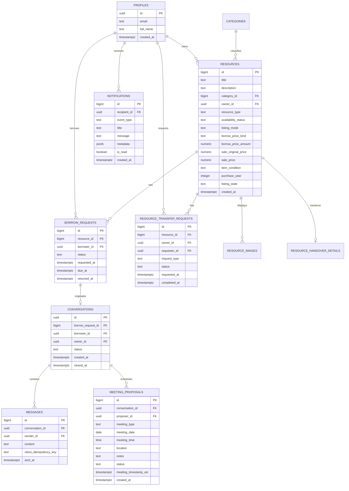

# CampusShare Database Design & Schema Reference

**Target Database:** PostgreSQL 15+ (Supabase)  
**Staging Project Ref:** `jxndjuslvccxgayoachm`  
**Security Model:** Row-Level Security (RLS) + SECURITY DEFINER RPCs + Explicit Privilege Grants

---

## 1. Entity-Relationship Diagram (ERD)

---

## 2. Table Specifications & Constraints

### A. `public.conversations`
- **Primary Key:** `id` (UUID, default `gen_random_uuid()`)
- **Foreign Keys:**
  - `borrow_request_id` -> `public.borrow_requests(id)` ON DELETE SET NULL *(Never cascade deletes conversation history)*
  - `borrower_id` -> `public.profiles(id)`
  - `owner_id` -> `public.profiles(id)`
- **Constraints:**
  - `conversation_no_self_chat`: `CHECK (borrower_id <> owner_id)`
  - `conversation_status_check`: `CHECK (status IN ('active', 'closed'))`
  - Unique index: `UNIQUE (borrow_request_id)` WHERE `borrow_request_id IS NOT NULL`

### B. `public.messages`
- **Primary Key:** `id` (BIGINT GENERATED ALWAYS AS IDENTITY)
- **Foreign Keys:**
  - `conversation_id` -> `public.conversations(id)` ON DELETE RESTRICT
  - `sender_id` -> `public.profiles(id)`
- **Constraints:**
  - `message_content_check`: `CHECK (length(trim(content)) > 0 AND length(content) <= 2000)`
  - Unique Index (Idempotency): `UNIQUE (conversation_id, client_idempotency_key)` WHERE `client_idempotency_key IS NOT NULL`

### C. `public.meeting_proposals`
- **Primary Key:** `id` (BIGINT GENERATED ALWAYS AS IDENTITY)
- **Foreign Keys:**
  - `conversation_id` -> `public.conversations(id)` ON DELETE RESTRICT
  - `proposer_id` -> `public.profiles(id)`
- **Constraints:**
  - `proposal_status_check`: `CHECK (status IN ('pending', 'accepted', 'declined', 'cancelled', 'superseded'))`
  - `proposal_type_check`: `CHECK (meeting_type IN ('handover', 'return'))`

### D. `public.notifications`
- **Primary Key:** `id` (BIGINT GENERATED ALWAYS AS IDENTITY)
- **Foreign Keys:**
  - `recipient_id` -> `public.profiles(id)` ON DELETE CASCADE
- **Indexes:**
  - `notifications_recipient_unread_idx` on `(recipient_id, created_at DESC)` WHERE `NOT is_read`

---

## 3. Core RPC Functions

1. **`approve_borrow_request(p_request_id bigint, p_due_at timestamptz)`**:
   - Atomically locks resource and request, marks request `approved`, resource `unavailable`, creates conversation, and triggers notification.
2. **`send_conversation_message(...)`**:
   - Validates caller membership (`auth.uid()`), checks conversation `active`, enforces idempotency, inserts message.
3. **`propose_meeting(...)`**:
   - Validates future time in `Asia/Kolkata`, supersedes prior proposals, inserts proposal.
4. **`respond_to_meeting_proposal(p_proposal_id bigint, p_action text)`**:
   - Handles `accept`, `decline`, or `cancel` with verification of active conversation.
5. **`mark_notifications_read(p_notification_ids bigint[], p_mark_all boolean)`**:
   - Securely marks caller's notifications as read without granting general table UPDATE permissions.
6. **`return_borrowed_resource(p_request_id bigint)`**:
   - Marks request `returned`, resource `available`, closes conversation, cancels remaining proposals.

